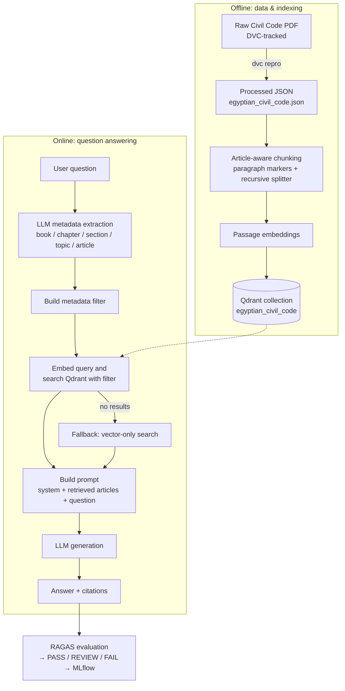

# ⚖️ Arabic Legal Document Q&A

**An Arabic–English legal question-answering system powered by Retrieval-Augmented Generation (RAG).**

The project focuses on answering questions about legal documents, starting with the Egyptian Civil Code. It retrieves relevant legal passages from a vector database and generates answers with legal article citations to help users trace answers back to their sources.

The project is designed around the challenges of legal AI: factual grounding, citation accuracy, multilingual retrieval, evaluation, and reliable API serving.

## 📌 Project Overview

Legal professionals and government authorities need to retrieve and interpret information from legal documents accurately. General-purpose language models can produce plausible but unsupported answers, making them unsuitable for legal use without appropriate grounding and evaluation.

This project implements a **Retrieval-Augmented Generation (RAG)** pipeline that combines legal document processing, embeddings, vector similarity search, metadata-based retrieval, and language model generation.

The current corpus is the Egyptian Civil Code, represented as structured JSON and split into searchable passages. The system supports Arabic and English legal questions and uses article-level metadata to retrieve relevant context and return source citations.

### Project Objectives

- Answer legal questions in Arabic and English.
- Retrieve relevant passages from the Egyptian Civil Code.
- Provide legal article citations with generated answers.
- Support configurable language model and embedding providers.
- Evaluate answer faithfulness, relevance, context retrieval, citation correctness, and harmful legal advice.
- Track evaluation experiments using MLflow.
- Expose the system through a FastAPI REST API.
- Test API behavior and performance using Locust.

## 🎯 Target Users

- **Law firms and legal professionals:** Find relevant provisions of the Egyptian Civil Code.
- **Government authorities:** Retrieve legal information from a structured legal corpus.
- **Legal researchers and students:** Explore legal articles and their relevance to specific questions.
- **AI and MLOps engineers:** Study multilingual RAG, vector search, evaluation and experiment tracking.

The system is a legal information retrieval and question-answering tool, not a replacement for qualified legal advice.

## 🧠 Core AI Capabilities

✅ Arabic + English Legal Question Answering  
✅ Retrieval-Augmented Generation (RAG)  
✅ Semantic Search over Legal Documents  
✅ Legal Article Metadata Extraction  
✅ Metadata-Filtered Vector Retrieval  
✅ Context-Grounded Answer Generation  
✅ Legal Citation Retrieval  
✅ Article-Aware Document Chunking  
✅ Multilingual Text Embeddings  
✅ Multiple LLM Providers (Ollama, vLLM, Cohere, Gemini & Qwen) 
✅ OpenAI-Compatible API Integration for vLLM
✅ RAG Evaluation with RAGAS  
✅ Faithfulness & Response Relevancy Evaluation  
✅ Citation Correctness & Harmful Legal Advice Checks  
✅ MLflow Evaluation Tracking  
✅ Reproducible Data Processing with DVC  
✅ Qdrant Vector Database Integration

## 🔀 System Workflow



**Chunking strategy.** An article that fits within `chunk_size` is kept whole. Longer articles are split on legal paragraph markers (Arabic `(١)` / `١)` style and English `1.` style); any paragraph still above the limit is split further with a `RecursiveCharacterTextSplitter`. Every chunk keeps the article's metadata (`article_number`, `book`, `chapter`, `section`, `topic`, `citation`, `is_repealed`, `source_page`) plus its `language`, `chunk_part`, and `chunk_count`.

## 💫 Key Features

- 📜 **Citation-first answers** – each response returns the supporting article citations alongside the generated text.
- 🔎 **Smart retrieval** – LLM-extracted metadata filters with automatic fallback to vector search.
- 🌍 **Arabic + English** – language-specific paragraph detection and prompt templates.
- 🔌 **Provider-agnostic design** – factories for both LLM providers and vector databases, selected via environment variables.
- 🧪 **Built-in evaluation** – RAGAS metrics, threshold-based quality gate, and per-case results logged to **MLflow**.
- 📦 **Reproducible data pipeline** – corpus built and versioned with **DVC**; the processed JSON is regenerated on demand.
- 🐳 **Containerised** – Dockerfiles for the API and for Qdrant, plus a `docker-compose.yml`.
- 🚦 **CI/CD** – GitHub Actions workflow (`.github/workflows/ci_cd.yml`).
- 📈 **Load-tested** – Locust scenario in `loadtest/` with results stored in `reports/`.
- 🧹 **Code quality** – `pre-commit` hooks, `uv` lockfile, and documented controllers/providers.

## 🧾 Data Preparation

The corpus is built from the bilingual (Arabic / English) Egyptian Civil Code PDF. A dedicated parser, [`src/arabic_legal_document_qa/data/parser.py`](src/arabic_legal_document_qa/data/parser.py), converts the PDF into a structured, article-level JSON file that the RAG pipeline chunks and indexes.

```text
data/raw/egyptian_civil_code.pdf  ──►  parser.py  ──►  data/processed/egyptian_civil_code.json
        (DVC-tracked)               (pypdf + regex)        (one record per article)
```

### Parsing steps

| # | Step | What it does |
|---|------|--------------|
| 1 | **Extract text** | `pypdf` reads the PDF page by page and keeps `(page_number, text)`, so every article can be traced back to its source page. |
| 2 | **Track the legal hierarchy** | The text is scanned line by line for `BOOK`, `CHAPTER`, and `SECTION` headings (Roman numerals) and numbered topic headings. Each article inherits the current book → chapter → section → topic. The hierarchy starts at *Preliminary Provisions / General Provisions*. |
| 3 | **Detect article headers** | Arabic headers (`مادة …`) and English headers (`Article N`) mark where a new article begins. |
| 4 | **Normalise article numbers** | Arabic-Indic digits (`٠–٩`) are converted to integers, including the reversed digit order produced by right-to-left PDF text extraction. |
| 5 | **Pair Arabic and English** | The Arabic and English halves of the same article are merged into a single record. Each text line is routed by script (Arabic Unicode range → `text_ar`, otherwise → `text_en`). If the two numbers disagree, the English (Western-digit) number is trusted. |
| 6 | **Handle repealed articles** | Repeal notices (`ألغيت`, `ملغاة`, `repealed`) and ranges such as *Articles 54–80 have been repealed* produce one placeholder record per article with `is_repealed: true` and empty text. |
| 7 | **Build the citation** | Every article gets a citation string: `Egyptian Civil Code, Article {n}`. |
| 8 | **Clean** | Records with no Arabic text are dropped (false article matches), except repealed articles, whose text is intentionally empty. |
| 9 | **QA report** | A post-processing check prints the articles that need a manual look: a missing language, or a number outside `1 … MAX_CIVIL_CODE_ARTICLE_NUMBER`. It is computed after the fact and not stored, so the JSON schema stays unchanged. |
| 10 | **Save** | The result is written as UTF-8 JSON with `ensure_ascii=False`, so Arabic text stays readable. |

### Output schema

Each record in `data/processed/egyptian_civil_code.json` looks like this (values are illustrative):

```json
{
  "article_number": 1,
  "book": "Preliminary Provisions",
  "chapter": "General Provisions",
  "section": null,
  "topic": null,
  "text_ar": "…",
  "text_en": "…",
  "is_repealed": false,
  "source_page": 12,
  "citation": "Egyptian Civil Code, Article 1"
}
```

| Field | Description |
|-------|-------------|
| `article_number` | Integer article number. |
| `book` / `chapter` / `section` / `topic` | Position of the article in the legal hierarchy (used later as retrieval filters). |
| `text_ar` / `text_en` | Arabic and English text of the article. |
| `is_repealed` | `true` for repealed articles (empty text). |
| `source_page` | PDF page where the article starts. |
| `citation` | Citation string returned with answers. |

### Running the data pipeline

```bash
# Fetch the DVC-tracked PDF and (re)build the processed JSON
dvc pull
dvc repro

# Or run the parser directly
uv run python src/arabic_legal_document_qa/data/parser.py
```

If `data/processed/egyptian_civil_code.json` does not exist when the API first needs it, the application runs `dvc repro` automatically to generate it.


## 🛠️ Tech Stack

[](https://fastapi.tiangolo.com/)
[](https://qdrant.tech/)
[](https://www.docker.com/)
[](https://mlflow.org/)
[](https://dvc.org/)
[](https://github.com/features/actions)
[](https://locust.io/)

| Layer | Technology |
|-------|------------|
| **API** | FastAPI, Pydantic, Uvicorn |
| **RAG orchestration** | LangChain (document loaders & text splitters) |
| **Vector database** | Qdrant |
| **LLM / embedding backends** | Qwen3 via Hugging Face Transformers & Sentence-Transformers · Ollama · vLLM (OpenAI-compatible API)· Cohere · Gemini |
| **Evaluation** | RAGAS (Faithfulness, ResponseRelevancy, LLMContextPrecision/Recall, AspectCritic) |
| **Experiment tracking** | MLflow |
| **Data versioning** | DVC |
| **Containers** | Docker, Docker Compose |
| **CI/CD** | GitHub Actions |
| **Load testing** | Locust |
| **Tooling** | uv, pre-commit, pyproject.toml |

## 📂 Project Structure

```text
├── .dvc/                         # DVC configuration
├── .github/
│   └── workflows/
│       └── ci_cd.yml             # CI/CD pipeline
├── data/
│   ├── raw/                      # Source documents (DVC-tracked)
│   ├── processed/                # egyptian_civil_code.json
│   ├── evaluation/               # JSONL evaluation cases (e.g. cases_v1.jsonl)
│   └── compression/              # Quantisation calibration data
├── docker/
│   ├── Dockerfile                # API image
│   ├── Qdrant.Dockerfile         # Qdrant image
│   └── docker-compose.yml        # Multi-service stack
├── loadtest/
│   └── locustfile.py             # Locust load-test scenario
├── reports/                      # Load-test & evaluation reports
├── src/
│   └── arabic_legal_document_qa/
│       ├── main.py               # FastAPI application entry point
│       ├── .env.example          # Environment variable template
│       ├── configs/
│       │   ├── config.py         # Settings (pydantic)
│       │   └── logging_config.py
│       ├── controllers/
│       │   ├── BaseController.py        # Settings & project paths
│       │   ├── DocumentController.py    # Load, split & chunk legal articles
│       │   ├── VectorDBController.py    # Embed, index & search
│       │   ├── RAGController.py         # End-to-end RAG pipeline
│       │   └── EvaluationController.py  # RAGAS evaluation + MLflow logging
│       ├── data/
│       │   ├── parser.py         # Corpus parsing
│       │   └── validators.py     # Corpus validation
│       ├── models/
│       │   ├── db_schemes/       # legal_query_metadata, rag_evaluation_case, retrieved_document
│       │   └── enums/            # ResponseEnum.py (response signals)
│       ├── routes/
│       │   ├── ask.py            # POST /ask
│       │   ├── document.py       # POST /index
│       │   ├── evaluation.py     # POST /evaluation
│       │   ├── health.py         # GET  /health
│       │   └── schemes/          # Request / response models
│       └── stores/
│           ├── llm/
│           │   ├── LLMEnums.py
│           │   ├── LLMInterface.py
│           │   ├── LLMProviderFactory.py
│           │   ├── providers/    # Cohere, Gemini, Ollama, Qwen, VLLM
│           │   └── templates/
│           │       └── locales/  # ar/ and en/ prompts: metadata_extraction.py, rag.py
│           └── vectordb/
│               ├── VectorDBEnums.py
│               ├── VectorDBInterface.py
│               ├── VectorDBProviderFactory.py
│               └── providers/    # QdrantDBProvider
├── tests/
│   └── eval/                     # Evaluation tests
├── dvc.yaml / dvc.lock           # Data pipeline definition & lock
├── mlflow.db                     # Local MLflow tracking store
├── pyproject.toml / uv.lock      # Dependencies (uv)
├── requirements.txt
├── .pre-commit-config.yaml
├── .python-version
└── README.md
```

## ⚙️ Setup & Installation

### Prerequisites

Before running the project, make sure the following tools and services are available:

- **Git** — to clone the repository.
- **Docker Desktop with Docker Compose** — to run the API and Qdrant containers.
- **Ollama** — if `OLLAMA` is selected as the generation or embedding backend.
- **Python and `uv`** — required only for local development without Docker.
- **DVC access** — required to download the tracked corpus if it is not already available locally.

The project exposes the API on port `8000`. Qdrant uses ports `6333` (HTTP) and `6334` (gRPC). Ensure these ports are available.

### Option 1: Run with Docker Compose

#### 1. Clone the repository

```bash
git clone https://github.com/BasmaBalam/Arabic-Legal-Document-QA.git
cd Arabic-Legal-Document-QA
```

Use the actual directory name created by Git if it differs.

#### 2. Configure the environment

Create the root `.env` file:

```bash
cp src/arabic_legal_document_qa/.env.example .env
```

Edit `.env` before starting the application. Choose the generation and embedding backends, set their corresponding model IDs, and provide credentials only when the selected providers require them.

For the default Docker setup, if Ollama runs on the host machine, configure:

```dotenv
OLLAMA_HOST=http://host.docker.internal:11434
```

The API container must be able to reach the Ollama service. The Compose configuration starts the API and Qdrant; it does not start Ollama or download Ollama models automatically.

If you use Ollama, start it and download the models required by your configuration before indexing the corpus. For example, if these are the model IDs you selected:

```bash
ollama pull qwen3:8b
ollama pull qwen3-embedding:0.6b
```

Use the actual model names supported by your installed Ollama version and configured providers.

#### 3. Start the application

```bash
docker compose -f docker/docker-compose.yml up --build -d
```

Check the container status and logs:

```bash
docker compose -f docker/docker-compose.yml ps
docker compose -f docker/docker-compose.yml logs app
docker compose -f docker/docker-compose.yml logs qdrant
```

Wait until the API and Qdrant are ready before sending requests. If a container is unhealthy or the application exits, inspect its logs first.

#### 4. Check the API

Open the interactive API documentation:

http://localhost:8000/docs

Check the health endpoint:

```bash
curl http://localhost:8000/api/v1/health
```

#### 5. Index the legal corpus

Run indexing once after the application and its required model services are ready:

```bash
curl -X POST http://localhost:8000/api/v1/index \
  -H "Content-Type: application/json" \
  -d '{"chunk_size": 1000, "overlap_size": 100, "do_reset": true}'
```

The `do_reset` option recreates the collection, so use it only when you intend to reset the existing index.

#### 6. Ask a question

```bash
curl -X POST http://localhost:8000/api/v1/ask \
  -H "Content-Type: application/json" \
  -d '{"question": "What does the Civil Code say about contracts of sale?", "limit": 10}'
```

The response contains the generated answer and its source citations.

### Option 2: Local development without Docker

#### 1. Install dependencies

Use the Python version specified in `.python-version`, then run:

```bash
uv sync
```

#### 2. Prepare the corpus

If the DVC-tracked files are not already available locally, configure access to the project's DVC remote and run:

```bash
dvc pull
dvc repro
```

The DVC remote must be accessible to the person running the project. If the processed JSON is already present and the pipeline does not need to be rebuilt, follow the repository's existing data setup instead.

#### 3. Configure the environment

The current `config.py` specifies this environment-file path:

```text
src/arabic_legal_document_qa/.env
```

Therefore, for local development, create the file at that location:

```bash
cp src/arabic_legal_document_qa/.env.example \
   src/arabic_legal_document_qa/.env
```

Edit the file to match the chosen providers and model IDs.

#### 4. Start the API

```bash
uv run uvicorn arabic_legal_document_qa.main:app \
  --reload --port 8000
```

The API is available at http://localhost:8000, and its interactive documentation is at http://localhost:8000/docs.

### Configuration

The project uses environment variables to configure its application, model providers, vector database, evaluation models, and experiment tracking.

The `.env.example` file documents the configuration variables. Copy it to the environment-file location required by the selected run mode, then configure the values required by that setup.

Do not commit actual API keys or other secrets. Hosted providers such as Cohere or Gemini require valid credentials when selected. Ollama and vLLM require their inference services to be running and reachable.

### Additional services and ports

| Component | Default address / port | Notes |
|---|---|---|
| FastAPI | `http://localhost:8000` | API and interactive documentation |
| Qdrant HTTP | `localhost:6333` | Vector database API |
| Qdrant gRPC | `localhost:6334` | Vector database gRPC |
| Ollama | `http://localhost:11434` on the host | Must be started separately when selected |
| vLLM | Configured by `VLLM_BASE_URL` | Must be started separately when selected |
| MLflow UI | `http://127.0.0.1:5000` in the local configuration | Start separately if you want to browse experiment runs |

The Docker Compose file does not start Ollama, vLLM, or an MLflow server. These services must be configured separately when required by the selected workflow.

### Troubleshooting

- **The API container exits during startup:** Inspect `docker compose -f docker/docker-compose.yml logs app` and verify that the required environment variables are configured.
- **Ollama connection errors:** Confirm that Ollama is running, the configured models are available, and `OLLAMA_HOST` points to an address reachable from the application container.
- **Qdrant is unhealthy:** Inspect the Qdrant container logs and verify that its health-check command is available in the image.
- **DVC download errors:** Verify that the configured DVC remote is accessible and that any required credentials are available.
- **Evaluation errors:** Verify the selected evaluation backend, model IDs, credentials, and evaluation dataset before running the evaluation endpoint.

## 🚀 API Endpoints

All routes are prefixed with `/api/v1`.

| Method | Endpoint | Description |
|--------|----------|-------------|
| `GET` | `/api/v1/health` | Health check and number of indexed chunks. |
| `POST` | `/api/v1/index` | Chunk the legal document, embed it, and index it into the vector database. |
| `POST` | `/api/v1/ask` | Answer a legal question using the RAG pipeline. |
| `POST` | `/api/v1/evaluation` | Run the RAGAS evaluation and log the experiment to MLflow. |

> Responses include a `signal` field whose values are defined by the `ResponseStatus` enum (`models/enums/ResponseEnum.py`). The examples below show the enum member names.

### `GET /api/v1/health`

```json
{
  "signal": "HEALTH_SUCCESS",
  "health_response": { "status": "healthy", "documents_indexed": 1234 }
}
```

### `POST /api/v1/index`

```bash
curl -X POST http://localhost:8000/api/v1/index \
  -H "Content-Type: application/json" \
  -d '{"chunk_size": 1000, "overlap_size": 100, "do_reset": true}'
```

| Field | Description |
|-------|-------------|
| `chunk_size` | Maximum preferred chunk size (characters). |
| `overlap_size` | Overlap used when a paragraph must be split further. |
| `do_reset` | Drop and recreate the collection before indexing. |

```json
{ "signal": "INDEXING_SUCCESS", "indexed_count": 1234 }
```

Failure: `400` with `CHUNKING_FAILED` or `INDEXING_FAILED`.

### `POST /api/v1/ask`

```bash
curl -X POST http://localhost:8000/api/v1/ask \
  -H "Content-Type: application/json" \
  -d '{"question": "ما هي أحكام الإيجار في القانون المدني المصري؟", "limit": 10}'
```

| Field | Description |
|-------|-------------|
| `question` | The legal question (Arabic or English). |
| `limit` | Maximum number of chunks to retrieve. |

```json
{
  "signal": "ANSWERING_SUCCESS",
  "answer": "…",
  "sources": ["Article 558", "Article 559"]
}
```

Failure: `400` with `ANSWERING_FAILED`.

### `POST /api/v1/evaluation`

Runs the configured evaluation cases through the full RAG pipeline, scores them with RAGAS, and logs parameters, metrics, and a per-case table to MLflow.

```bash
curl -X POST http://localhost:8000/api/v1/evaluation \
  -H "Content-Type: application/json" \
  -d '{"chunk_size": 1000, "overlap_size": 100}'
```

```json
{
  "signal": "EVALUATION_SUCCESS",
  "status": "REVIEW",
  "scores": {
    "no_harmful_legal_advice": 1.0,
    "citation_correctness": 1.0,
    "faithfulness": 0.82,
    "response_relevancy": 0.88,
    "context_precision": 0.79,
    "context_recall": 0.85
  },
  "questions_evaluated": 20
}
```

Failure: `400` with `EVALUATION_FAILED`.

## 👨‍💻 Author

**Basma Balam**
AI Engineer | Data Science | NLP & Generative AI
