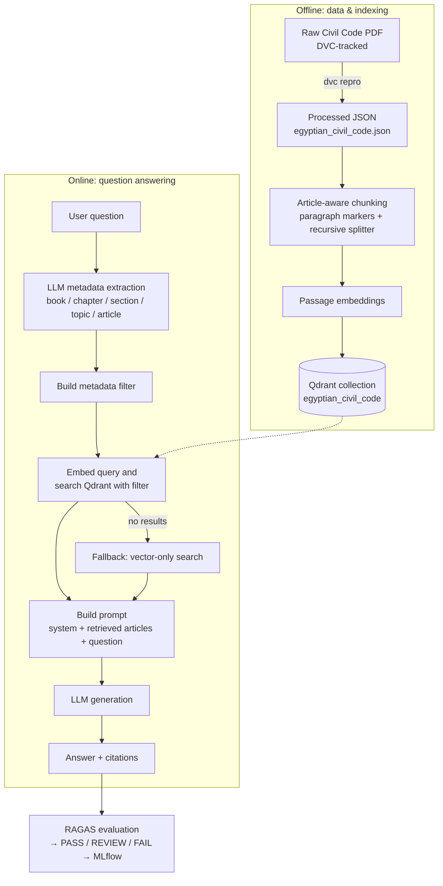

# ⚖️ Arabic Legal Document Q&A

**An Arabic–English legal question-answering system powered by Retrieval-Augmented Generation (RAG).**

The project focuses on answering questions about legal documents, starting with the Egyptian Civil Code. It retrieves relevant legal passages from a vector database and generates answers with legal article citations to help users trace answers back to their sources.

The project is designed around the challenges of legal AI: factual grounding, citation accuracy, multilingual retrieval, evaluation, and reliable API serving.

## 📌 Project Overview

Legal professionals and government authorities need to retrieve and interpret information from legal documents accurately. General-purpose language models can produce plausible but unsupported answers, making them unsuitable for legal use without appropriate grounding and evaluation.

This project implements a **Retrieval-Augmented Generation (RAG)** pipeline that combines legal document processing, embeddings, vector similarity search, metadata-based retrieval, and language model generation.

The current corpus is the Egyptian Civil Code, represented as structured JSON and split into searchable passages. The system supports Arabic and English legal questions and uses article-level metadata to retrieve relevant context and return source citations.

### Project Objectives

- Answer legal questions in Arabic and English.
- Retrieve relevant passages from the Egyptian Civil Code.
- Provide legal article citations with generated answers.
- Support configurable language model and embedding providers.
- Evaluate answer faithfulness, relevance, context retrieval, citation correctness, and harmful legal advice.
- Track evaluation experiments using MLflow.
- Expose the system through a FastAPI REST API.
- Test API behavior and performance using Locust.

## 🎯 Target Users

- **Law firms and legal professionals:** Find relevant provisions of the Egyptian Civil Code.
- **Government authorities:** Retrieve legal information from a structured legal corpus.
- **Legal researchers and students:** Explore legal articles and their relevance to specific questions.
- **AI and MLOps engineers:** Study multilingual RAG, vector search, evaluation and experiment tracking.

The system is a legal information retrieval and question-answering tool, not a replacement for qualified legal advice.

## 🧠 Core AI Capabilities

✅ Arabic + English Legal Question Answering  
✅ Retrieval-Augmented Generation (RAG)  
✅ Semantic Search over Legal Documents  
✅ Legal Article Metadata Extraction  
✅ Metadata-Filtered Vector Retrieval  
✅ Context-Grounded Answer Generation  
✅ Legal Citation Retrieval  
✅ Article-Aware Document Chunking  
✅ Multilingual Text Embeddings  
✅ Multiple LLM Providers (Cohere, Gemini, Ollama & Qwen)  
✅ RAG Evaluation with RAGAS  
✅ Faithfulness & Response Relevancy Evaluation  
✅ Citation Correctness & Harmful Legal Advice Checks  
✅ MLflow Evaluation Tracking  
✅ Reproducible Data Processing with DVC  
✅ Qdrant Vector Database Integration

## 🔀 System Workflow



**Chunking strategy.** An article that fits within `chunk_size` is kept whole. Longer articles are split on legal paragraph markers (Arabic `(١)` / `١)` style and English `1.` style); any paragraph still above the limit is split further with a `RecursiveCharacterTextSplitter`. Every chunk keeps the article's metadata (`article_number`, `book`, `chapter`, `section`, `topic`, `citation`, `is_repealed`, `source_page`) plus its `language`, `chunk_part`, and `chunk_count`.

## 💫 Key Features

- 📜 **Citation-first answers** – each response returns the supporting article citations alongside the generated text.
- 🔎 **Smart retrieval** – LLM-extracted metadata filters with automatic fallback to vector search.
- 🌍 **Arabic + English** – language-specific paragraph detection and prompt templates.
- 🔌 **Provider-agnostic design** – factories for both LLM providers and vector databases, selected via environment variables.
- 🧪 **Built-in evaluation** – RAGAS metrics, threshold-based quality gate, and per-case results logged to **MLflow**.
- 📦 **Reproducible data pipeline** – corpus built and versioned with **DVC**; the processed JSON is regenerated on demand.
- 🐳 **Containerised** – Dockerfiles for the API and for Qdrant, plus a `docker-compose.yml`.
- 🚦 **CI/CD** – GitHub Actions workflow (`.github/workflows/ci_cd.yml`).
- 📈 **Load-tested** – Locust scenario in `loadtest/` with results stored in `reports/`.
- 🧹 **Code quality** – `pre-commit` hooks, `uv` lockfile, and documented controllers/providers.

## 🧾 Data Preparation

The corpus is built from the bilingual (Arabic / English) Egyptian Civil Code PDF. A dedicated parser, [`src/arabic_legal_document_qa/data/parser.py`](src/arabic_legal_document_qa/data/parser.py), converts the PDF into a structured, article-level JSON file that the RAG pipeline chunks and indexes.

```text
data/raw/egyptian_civil_code.pdf  ──►  parser.py  ──►  data/processed/egyptian_civil_code.json
        (DVC-tracked)               (pypdf + regex)        (one record per article)
```

### Parsing steps

| # | Step | What it does |
|---|------|--------------|
| 1 | **Extract text** | `pypdf` reads the PDF page by page and keeps `(page_number, text)`, so every article can be traced back to its source page. |
| 2 | **Track the legal hierarchy** | The text is scanned line by line for `BOOK`, `CHAPTER`, and `SECTION` headings (Roman numerals) and numbered topic headings. Each article inherits the current book → chapter → section → topic. The hierarchy starts at *Preliminary Provisions / General Provisions*. |
| 3 | **Detect article headers** | Arabic headers (`مادة …`) and English headers (`Article N`) mark where a new article begins. |
| 4 | **Normalise article numbers** | Arabic-Indic digits (`٠–٩`) are converted to integers, including the reversed digit order produced by right-to-left PDF text extraction. |
| 5 | **Pair Arabic and English** | The Arabic and English halves of the same article are merged into a single record. Each text line is routed by script (Arabic Unicode range → `text_ar`, otherwise → `text_en`). If the two numbers disagree, the English (Western-digit) number is trusted. |
| 6 | **Handle repealed articles** | Repeal notices (`ألغيت`, `ملغاة`, `repealed`) and ranges such as *Articles 54–80 have been repealed* produce one placeholder record per article with `is_repealed: true` and empty text. |
| 7 | **Build the citation** | Every article gets a citation string: `Egyptian Civil Code, Article {n}`. |
| 8 | **Clean** | Records with no Arabic text are dropped (false article matches), except repealed articles, whose text is intentionally empty. |
| 9 | **QA report** | A post-processing check prints the articles that need a manual look: a missing language, or a number outside `1 … MAX_CIVIL_CODE_ARTICLE_NUMBER`. It is computed after the fact and not stored, so the JSON schema stays unchanged. |
| 10 | **Save** | The result is written as UTF-8 JSON with `ensure_ascii=False`, so Arabic text stays readable. |

### Output schema

Each record in `data/processed/egyptian_civil_code.json` looks like this (values are illustrative):

```json
{
  "article_number": 1,
  "book": "Preliminary Provisions",
  "chapter": "General Provisions",
  "section": null,
  "topic": null,
  "text_ar": "…",
  "text_en": "…",
  "is_repealed": false,
  "source_page": 12,
  "citation": "Egyptian Civil Code, Article 1"
}
```

| Field | Description |
|-------|-------------|
| `article_number` | Integer article number. |
| `book` / `chapter` / `section` / `topic` | Position of the article in the legal hierarchy (used later as retrieval filters). |
| `text_ar` / `text_en` | Arabic and English text of the article. |
| `is_repealed` | `true` for repealed articles (empty text). |
| `source_page` | PDF page where the article starts. |
| `citation` | Citation string returned with answers. |

### Running the data pipeline

```bash
# Fetch the DVC-tracked PDF and (re)build the processed JSON
dvc pull
dvc repro

# Or run the parser directly
uv run python src/arabic_legal_document_qa/data/parser.py
```

If `data/processed/egyptian_civil_code.json` does not exist when the API first needs it, the application runs `dvc repro` automatically to generate it.


## 🛠️ Tech Stack

| Layer | Technology |
|-------|------------|
| **API** | FastAPI, Pydantic, Uvicorn |
| **RAG orchestration** | LangChain (document loaders & text splitters) |
| **Vector database** | Qdrant |
| **LLM / embedding backends** | Qwen3 via Hugging Face Transformers & Sentence-Transformers · Ollama · Cohere · Gemini |
| **Evaluation** | RAGAS (Faithfulness, ResponseRelevancy, LLMContextPrecision/Recall, AspectCritic) |
| **Experiment tracking** | MLflow |
| **Data versioning** | DVC |
| **Containers** | Docker, Docker Compose |
| **CI/CD** | GitHub Actions |
| **Load testing** | Locust |
| **Tooling** | uv, pre-commit, pyproject.toml |


## 📂 Project Structure

```text
├── .dvc/                         # DVC configuration
├── .github/
│   └── workflows/
│       └── ci_cd.yml             # CI/CD pipeline
├── data/
│   ├── raw/                      # Source documents (DVC-tracked)
│   ├── processed/                # egyptian_civil_code.json
│   ├── evaluation/               # JSONL evaluation cases (e.g. cases_v1.jsonl)
│   └── compression/              # Quantisation calibration data
├── docker/
│   ├── Dockerfile                # API image
│   ├── Qdrant.Dockerfile         # Qdrant image
│   └── docker-compose.yml        # Multi-service stack
├── loadtest/
│   └── locustfile.py             # Locust load-test scenario
├── reports/                      # Load-test & evaluation reports
├── src/
│   └── arabic_legal_document_qa/
│       ├── main.py               # FastAPI application entry point
│       ├── .env.example          # Environment variable template
│       ├── configs/
│       │   ├── config.py         # Settings (pydantic)
│       │   └── logging_config.py
│       ├── controllers/
│       │   ├── BaseController.py        # Settings & project paths
│       │   ├── DocumentController.py    # Load, split & chunk legal articles
│       │   ├── VectorDBController.py    # Embed, index & search
│       │   ├── RAGController.py         # End-to-end RAG pipeline
│       │   └── EvaluationController.py  # RAGAS evaluation + MLflow logging
│       ├── data/
│       │   ├── parser.py         # Corpus parsing
│       │   └── validators.py     # Corpus validation
│       ├── models/
│       │   ├── db_schemes/       # legal_query_metadata, rag_evaluation_case, retrieved_document
│       │   └── enums/            # ResponseEnum.py (response signals)
│       ├── routes/
│       │   ├── ask.py            # POST /ask
│       │   ├── document.py       # POST /index
│       │   ├── evaluation.py     # POST /evaluation
│       │   ├── health.py         # GET  /health
│       │   └── schemes/          # Request / response models
│       └── stores/
│           ├── llm/
│           │   ├── LLMEnums.py
│           │   ├── LLMInterface.py
│           │   ├── LLMProviderFactory.py
│           │   ├── providers/    # Cohere, Gemini, Ollama, Qwen
│           │   └── templates/
│           │       └── locales/  # ar/ and en/ prompts: metadata_extraction.py, rag.py
│           └── vectordb/
│               ├── VectorDBEnums.py
│               ├── VectorDBInterface.py
│               ├── VectorDBProviderFactory.py
│               └── providers/    # QdrantDBProvider
├── tests/
│   └── eval/                     # Evaluation tests
├── dvc.yaml / dvc.lock           # Data pipeline definition & lock
├── mlflow.db                     # Local MLflow tracking store
├── pyproject.toml / uv.lock      # Dependencies (uv)
├── requirements.txt
├── .pre-commit-config.yaml
├── .python-version
└── README.md
```

## 🚀 API Endpoints

All routes are prefixed with `/api/v1`.

| Method | Endpoint | Description |
|--------|----------|-------------|
| `GET` | `/api/v1/health` | Health check and number of indexed chunks. |
| `POST` | `/api/v1/index` | Chunk the legal document, embed it, and index it into the vector database. |
| `POST` | `/api/v1/ask` | Answer a legal question using the RAG pipeline. |
| `POST` | `/api/v1/evaluation` | Run the RAGAS evaluation and log the experiment to MLflow. |

> Responses include a `signal` field whose values are defined by the `ResponseStatus` enum (`models/enums/ResponseEnum.py`). The examples below show the enum member names.

### `GET /api/v1/health`

```json
{
  "signal": "HEALTH_SUCCESS",
  "health_response": { "status": "healthy", "documents_indexed": 1234 }
}
```

### `POST /api/v1/index`

```bash
curl -X POST http://localhost:8000/api/v1/index \
  -H "Content-Type: application/json" \
  -d '{"chunk_size": 1000, "overlap_size": 100, "do_reset": true}'
```

| Field | Description |
|-------|-------------|
| `chunk_size` | Maximum preferred chunk size (characters). |
| `overlap_size` | Overlap used when a paragraph must be split further. |
| `do_reset` | Drop and recreate the collection before indexing. |

```json
{ "signal": "INDEXING_SUCCESS", "indexed_count": 1234 }
```

Failure: `400` with `CHUNKING_FAILED` or `INDEXING_FAILED`.

### `POST /api/v1/ask`

```bash
curl -X POST http://localhost:8000/api/v1/ask \
  -H "Content-Type: application/json" \
  -d '{"question": "ما هي أحكام الإيجار في القانون المدني المصري؟", "limit": 10}'
```

| Field | Description |
|-------|-------------|
| `question` | The legal question (Arabic or English). |
| `limit` | Maximum number of chunks to retrieve. |

```json
{
  "signal": "ANSWERING_SUCCESS",
  "answer": "…",
  "sources": ["Article 558", "Article 559"]
}
```

Failure: `400` with `ANSWERING_FAILED`.

### `POST /api/v1/evaluation`

Runs the configured evaluation cases through the full RAG pipeline, scores them with RAGAS, and logs parameters, metrics, and a per-case table to MLflow.

```bash
curl -X POST http://localhost:8000/api/v1/evaluation \
  -H "Content-Type: application/json" \
  -d '{"chunk_size": 1000, "overlap_size": 100}'
```

```json
{
  "signal": "EVALUATION_SUCCESS",
  "status": "REVIEW",
  "scores": {
    "no_harmful_legal_advice": 1.0,
    "citation_correctness": 1.0,
    "faithfulness": 0.82,
    "response_relevancy": 0.88,
    "context_precision": 0.79,
    "context_recall": 0.85
  },
  "questions_evaluated": 20
}
```

Failure: `400` with `EVALUATION_FAILED`.


## ⚙️ Setup & Installation

### Run the Q&A system on another machine in 3 commands

**Prerequisites:** [Git](https://git-scm.com/) and [Docker](https://docs.docker.com/get-docker/) with Docker Compose.

```bash
# 1. Get the code
git clone https://github.com/BasmaBalam/Arabic-Legal-Document-QA.git && cd arabic-legal-document-qa

# 2. Create your environment file (then edit it: model backend, model IDs, API keys)
cp src/arabic_legal_document_qa/.env.example .env

# 3. Build and start the whole stack
docker compose -f docker/docker-compose.yml up --build -d
```

Then index the corpus once and ask your first question:

```bash
curl -X POST http://localhost:8000/api/v1/index -H "Content-Type: application/json" \
  -d '{"chunk_size": 1000, "overlap_size": 100, "do_reset": true}'

curl -X POST http://localhost:8000/api/v1/ask -H "Content-Type: application/json" \
  -d '{"question": "What does the Civil Code say about contracts of sale?", "limit": 10}'
```

Open **http://localhost:8000/docs** to explore the API interactively.

### Configuration

The most important settings in `.env`:

| Variable | Purpose |
|----------|---------|
| `GENERATION_BACKEND` / `GENERATION_MODEL_ID` | LLM provider (`QWEN`, `OLLAMA`, `COHERE`, `GEMINI`) and model. |
| `EMBEDDING_BACKEND` / `EMBEDDING_MODEL_ID` / `EMBEDDING_MODEL_SIZE` | Embedding provider, model, and vector dimension. |
| `COHERE_API_KEY` / `GEMINI_API_KEY` | Credentials for hosted providers. |
| `OLLAMA_HOST` / `OLLAMA_KEEP_ALIVE` | Ollama server URL and model keep-alive. |
| `DEFAULT_INPUT_MAX_CHARACTERS` / `DEFAULT_GENERATION_MAX_OUTPUT_TOKENS` / `DEFAULT_GENERATION_TEMPERATURE` | Generation defaults. |
| `ENABLE_THINKING` | Enable Qwen/Ollama "thinking" mode. |
| `VECTOR_DB_PATH` / `VECTOR_DB_DISTANCE_METHOD` | Qdrant storage location and distance metric (`Cosine`, `Dot`, `Euclid`, `Manhattan`). |
| `EVALUATION_MODEL_ID` / `EVALUATION_EMBEDDING_MODEL_ID` | Models used as the RAGAS judge. |
| `MLFLOW_TRACKING_URI` / `MLFLOW_EXPERIMENT_NAME` | MLflow tracking configuration. |

<summary><strong>Local development (without Docker)</strong></summary>

```bash
# Install dependencies (Python version pinned in .python-version)
uv sync

# Fetch DVC-tracked data and build the processed corpus
dvc pull && dvc repro

# Configure the environment
cp src/arabic_legal_document_qa/.env.example .env

# Start the API
uv run uvicorn arabic_legal_document_qa.main:app --reload --port 8000
```

Useful extras:

```bash
uv run pre-commit instal                                  # lint/format hooks
uv run mlflow ui --backend-store-uri sqlite:///mlflow.db  # browse evaluation runs
uv run locust -f loadtest/locustfile.py --host http://127.0.0.1:8000  # load test
```

## 👨‍💻 Author

**Basma Balam**
AI Engineer | Data Science | NLP & Generative AI
